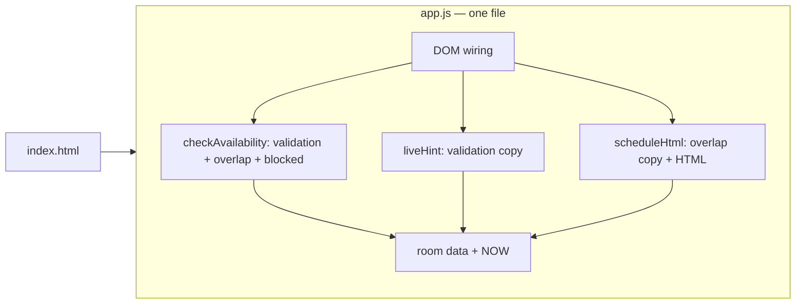
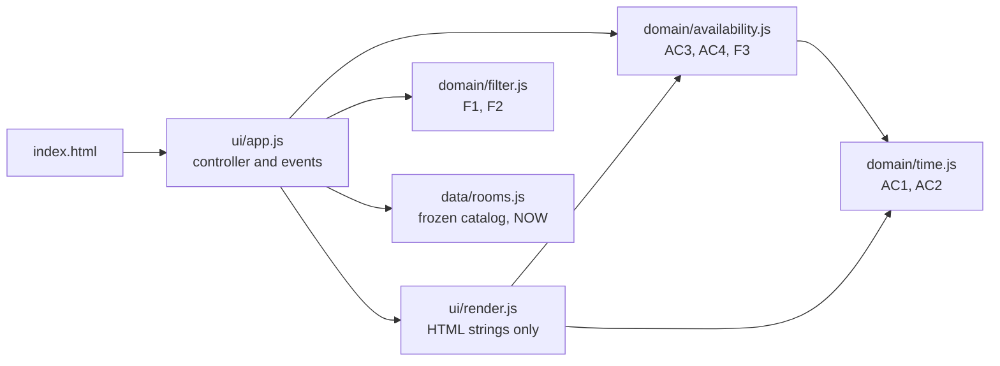

# Assignment #04 — Analysis, Refactoring and Quality Report

Smart Campus Room Availability Checker. Author: Olzhas Koishybek. AI assistant: Claude (Anthropic), see `AI_USE.md`.

## 0. Baseline

The Assignment #03 prototype was reconstructed as an equivalent minimal version in `initial/` (allowed by the brief). It checks one room ("Room 204") against fictional bookings at a fixed time, 2026-11-09 09:00. Baseline recorded before any change:

| Command | Result |
|---|---|
| `cd initial && npm test` | 8 tests, 8 passed, 0 failed (`docs/test-results-initial.txt`) |

Acceptance criteria preserved throughout: AC1 valid time (all fields present, end after start, not in the past), AC2 maximum 120 minutes, AC3 blocked room is never available, AC4 overlap rules (touching intervals allowed, overlapping rejected), AC5 booking data is immutable, AC6 clear, responsive feedback.

## 1. Task #01 — Codebase analysis

### Context given to the AI assistant

```
Repository map:
  initial/index.html   form (date, start, end), result <p>, booking <ul>
  initial/app.js       NOW constant, one `room` object, toMin(), checkAvailability(),
                       liveHint(), scheduleHtml(), DOM wiring, module.exports for tests
  initial/tests/baseline.test.js   node:test checks for AC1–AC5
Acceptance criteria: AC1–AC6 (listed above).
New requirements: catalog of ≥4 rooms (id, name, capacity, equipment, blocked, bookings);
  F1 capacity >= attendees; F2 room has ALL selected equipment; F3 blocked never available;
  F4 clear empty state; F5 switching room refreshes the result.
Constraints: plain HTML/CSS/JS, no login/payments/APIs/DB, fictional data only,
  keep AC1–AC6 behaviour, small incremental changes, not a rewrite.
Ask: list maintainability risks with file/function references, then a prioritised plan. No code yet.
```

### Maintainability risks

| # | Risk | Evidence (file / function) | Impact |
|---|---|---|---|
| R1 | Time validation is duplicated | `initial/app.js` `checkAvailability()` lines 29–31 and `liveHint()` lines 48–50 repeat the same three rules and messages | A rule change (e.g. 120 → 90 min) must be made twice; the two can drift apart |
| R2 | Overlap rule is duplicated | `checkAvailability()` line 37 and `scheduleHtml()` line 64 both compute `s < be && e > bs` | The schedule highlight and the verdict could disagree after an edit |
| R3 | Single global room hard-wired into the rules | `checkAvailability()` reads the module-level `room` instead of receiving it | Cannot support a catalog; F5 ("use the chosen room's bookings") is impossible without changing every function |
| R4 | Business rules mixed with DOM code | Same file contains data, rules, HTML strings and event listeners (`DOMContentLoaded` block) | Rules can only be tested through a `typeof document` guard; UI cannot be tested at all |
| R5 | Magic numbers and repeated parsing | `120` literal twice; `NOW.split("T")` parsed in two functions (lines 27, 46) | Small, but adds to R1 drift risk |

### Prioritised improvement plan (made before editing code)

1. Extract time parsing and validation into one module (`time.js`) — fixes R1, R5. Lowest risk, covered by existing AC1/AC2 tests.
2. Extract the overlap rule and availability check into `availability.js`, taking the room as a parameter — fixes R2, R3. Covered by AC3/AC4.
3. Move data into `data/rooms.js`, extend to a 5-room catalog and deep-freeze it — AC5 and catalog requirement.
4. Add `filter.js` (F1, F2) as a pure function, with tests first for the boundaries.
5. Separate HTML rendering (`render.js`) from event wiring (`app.js`) — fixes R4; then add jsdom UI tests for F4/F5.
6. Run all tests and review the diff after every step.

### AI suggestions rejected or modified

- **Rejected:** when the selected room disappears after a filter change, the first draft auto-selected the first remaining room. I rejected it: the app would then show "available" for a room the user never chose. The final behaviour clears the selection and says "Choose a room first" (covered by the third UI test).
- **Modified:** the first AI-written UI test selected a room by setting `radio.checked = true` and firing only a `change` event. It passed, but a real-browser check (Playwright) showed that clicking a room did nothing: a real click fires `input` before `change`, `input` re-rendered the list, and the `change` event came from a detached element. The test was changed to `radio.click()`, which then failed (19/21) and reproduced the bug; the handler was fixed and it passed (21/21). Details in `AI_USE.md`.

## 2. Task #02 — Feature extension

Implemented in `final/`:

- Catalog of 5 fictional rooms (`src/data/rooms.js`), each with `id`, `name`, `capacity`, `equipment`, `blocked`, `bookings`. One room (R-415) is blocked.
- Filters: attendees (F1, `capacity >= attendees`) and equipment chips (F2, `every` selected item must be present) in `src/domain/filter.js`.
- Only matching rooms are shown; the counter shows "N of 5 rooms match"; an empty state explains how to widen the search (F4).
- `checkAvailability(room, request, now)` receives the chosen room, so only that room's bookings are used. After the first check, changing the room, filters or times re-computes the result (F5).
- Original time and overlap validation unchanged in behaviour (same messages, same boundaries).

Demonstrations (screenshots in `docs/`, all produced by an automated Playwright run with no console errors):

| Scenario | Outcome |
|---|---|
| Successful filtering: 15 attendees + projector | 3 of 5 rooms (204, 310, 520) — `screenshot-conflict.png` |
| Unsuccessful filtering: 100 attendees | Empty state — `screenshot-empty.png` |
| Availability check fails: Lecture Hall 204, 10:30–11:30 | "busy: overlaps with Software Engineering lecture" |
| Room switching → success: Board Room 520, same slot | "available" — `screenshot-available.png` |
| Responsive layout at 390 px | `screenshot-mobile.png` |

## 3. Task #03 — Refactoring

### Before



### After



Dependencies point one way: UI → domain → nothing. Domain modules never import data or touch the DOM.

### Design decisions

1. **Room passed as a parameter, data kept out of the domain layer.** `checkAvailability(room, request, now)` cannot accidentally read another room's bookings, because it has no access to the catalog. This directly enforces "the availability check must use the chosen room's bookings" and makes tests independent of UI state. `now` is also a parameter, so the fixed time is injected rather than global.
2. **One rule, one place; the UI reuses it.** The live hint and the schedule highlight call the same `validateSlot()` and `conflictsFor()` as the final verdict, so the hint, the red highlighted booking and the result message can no longer disagree (they could in the baseline, R1/R2).
3. **Deep-frozen data instead of defensive copies.** `deepFreeze()` makes the whole catalog immutable (AC5); any write throws `TypeError` in strict/module code, which the AC5 test asserts. Cheaper and stricter than copying on every check.
4. **Clear the selection when the room is filtered out** instead of auto-selecting another room (see rejected suggestion above), so a result is never shown for a room the user did not choose.

## 4. Task #04 — Automated testing

Framework: Node.js built-in test runner (`node:test`) + `jsdom` for UI checks. Commands and real results:

| Version | Command | Total | Passed | Failed |
|---|---|---|---|---|
| Initial | `cd initial && npm test` | 8 | 8 | 0 |
| Final | `cd final && npm install && npm test` | 21 | 21 | 0 |

Full output in `docs/test-results-initial.txt` and `docs/test-results-final.txt`.

Final test inventory:

| File | Tests | Covers |
|---|---|---|
| `tests/regression.test.js` | 9 | AC1 (order, past, missing), AC2 **120 vs 121**, AC3/F3 blocked, AC4 **touching vs overlapping** (partial and enclosing), AC5 no mutation + frozen |
| `tests/filter.test.js` | 9 | Catalog shape, F1 **capacity 20 vs 21**, F2 all vs some equipment, F1+F2 combined, F3 blocked match, F4 empty, F5 same slot different rooms |
| `tests/ui.test.js` | 3 | Integration through the real `index.html` + all modules: empty state, room switch refreshes result, filtered-out room is deselected |

### Do the tests actually catch bugs? (mutation check)

Three deliberate faults were injected one at a time, the suite was run, and the code restored:

| Injected fault | Tests that failed |
|---|---|
| `capacity >= needed` → `>` | F1 exact capacity, F3 blocked match (19/21) |
| overlap `<` → `<=` (touching treated as overlap) | AC4 touching, AC4 overlapping (19/21) |
| allow 121 minutes | AC2 121 minutes (20/21) |

### Bug found by testing

The UI room-selection bug described in Task #01 was found by a Playwright browser run, reproduced by an improved UI test (19/21 before the fix) and fixed in `src/ui/app.js` (21/21 after).

## 5. Task #05 — Quality evaluation

| Measure | Initial | Final | How it was obtained |
|---|---|---|---|
| Automated tests passed / total | 8 / 8 | 21 / 21 | `npm test` in each folder, output saved in `docs/` |
| Requirements covered by tests | AC1–AC5 | AC1–AC5, F1–F5, UI | Test names map to criteria (table above) |
| Duplicated logic locations | 3 duplicated blocks: validation (lines 29–31 / 48–50), overlap (37 / 64), NOW parsing (27 / 46) | 0 — each rule exists once | `grep` for `e <= s`, `s < be && e > bs`, `NOW.split` in `initial/app.js`; same rule patterns in `final/src` return one location each |
| Duplicated logic removed | — | 3 | Difference of the row above |
| Modules / responsibilities | 1 file (`app.js`, 97 lines): data + rules + HTML + events | 6 modules (226 lines): data, time, availability, filter, render, app controller | `wc -l`; responsibilities from the diagrams |
| UI testable automatically | No | Yes (3 jsdom tests) | Presence of `tests/ui.test.js` |

Line count went up because the final version does more (5 rooms, filters, empty state, accessibility, escaping); it is reported for transparency, not as a quality score.

### Remaining limitations

- Typing in the attendees field or toggling equipment re-renders the whole room list, so keyboard focus inside the room list is lost after a re-render; a keyed DOM update would fix this.
- UI tests run in jsdom, not a real browser; the room-click bug showed this gap. The real-browser check was a one-off Playwright script, not part of `npm test`.
- Only one fixed day has bookings; no opening hours, overnight bookings or time zones; nothing can actually be booked (out of scope).
- Equipment names are a hard-coded list in `rooms.js`.
